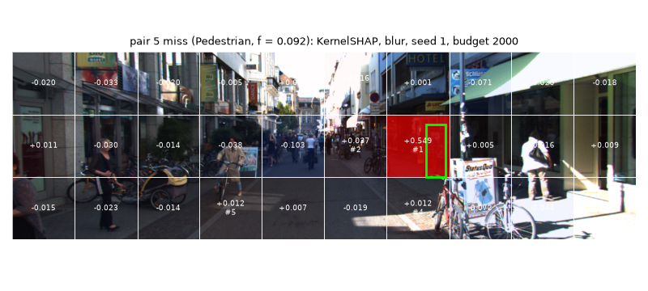
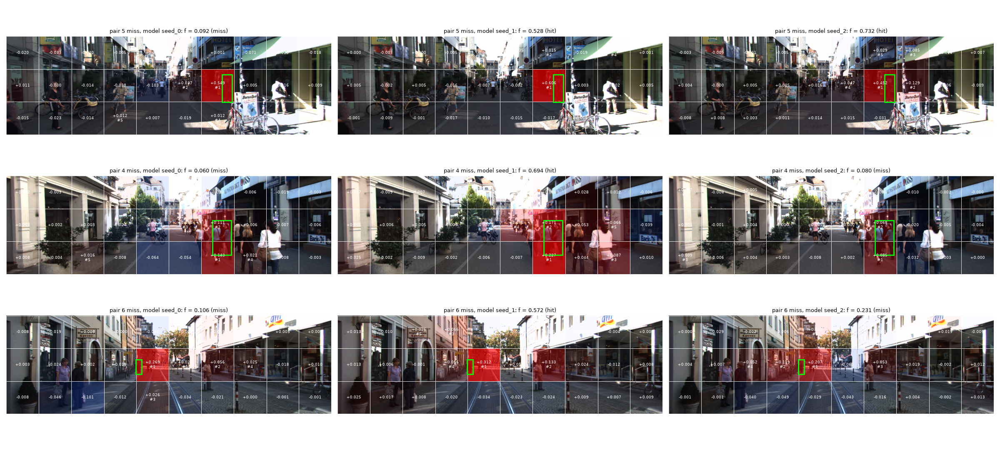
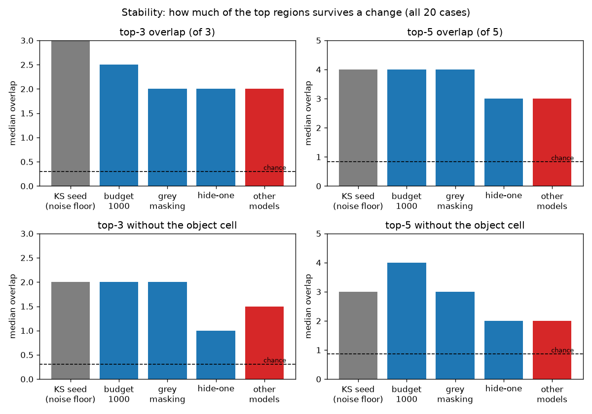
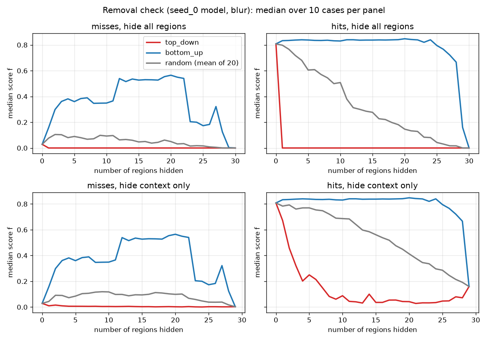

# adas-perception-failures

Why does a camera detector miss a pedestrian or a cyclist? This project fine-tunes YOLO26n on KITTI and uses regional Shapley values (KernelSHAP) to see which parts of a picture an object's score depends on. It compares 10 missed objects with 10 matched detected ones, and checks how much the answer changes with the masking, the sampling seed, the sample budget and three retrained copies of the model.

Full text: [report.md](report.md). Dataset: [splits/DATASET.md](splits/DATASET.md).

## Results in brief

- The cell around the object is the strongest region in 18 of 20 cases.
- The surrounding regions stay similar across seeds, budgets and maskings, and change more between retrained copies (rank correlation 0.75 between seeds, 0.41 between models).
- Four of the 10 misses are detected by another trained copy.
- Hiding the cells that the map marks as negative lifts the score of the misses from a median of 0.03 to a peak of 0.63.
- 10 misses, 10 hits, simple masking fills, one main model. The maps show what a score depends on, not what caused a miss.



*Base map of a missed pedestrian (score 0.092). Red cells raise the score, blue cells lower it, the green box is the object.*



*Three objects that the main model misses (left column). The other copies detect some of them.*



*How much of the top regions survives a change. Grey is sampling noise, red is another trained model, the dashed line is chance.*



*Score while regions are hidden. Red: largest value first. Blue: most negative first. Grey: random order.*

KITTI pictures: Geiger, Lenz and Urtasun, CVPR 2012, CC BY-NC-SA 3.0, with a grid and numbers drawn on top ([attribution](results/maps_shared/ATTRIBUTION.md)).

## Run it

Each level needs the ones above it.

Level 1, this repository only:

```
conda env create -f environment.yml
conda activate adas
python -m pytest
python -m explain_adas.make_report
```

`make_report` writes 6 tables to `results/tables/` (open `tables.md` first) and 2 charts to `results/figures/`. With the KITTI images and labels in `data/kitti/` (folder layout in [splits/DATASET.md](splits/DATASET.md)), it also writes 22 maps to `results/maps/`.

Level 2, plus an NVIDIA GPU and trained models at `data/runs/seed_0/weights/last.pt` (also `seed_1` and `seed_2`), which level 3 makes. `python -m explain_adas.smoke_test` takes about 30 seconds. The full pipeline, in this order:

```
python -m explain_adas.run_baseline seed_0
python -m explain_adas.run_kernel_shap seed_0
python -m explain_adas.run_kernel_shap seed_1 base
python -m explain_adas.run_kernel_shap seed_2 base
python -m explain_adas.run_removal seed_0
python -m explain_adas.run_removal seed_0 context
python -m explain_adas.compare_settings seed_0
python -m explain_adas.compare_models
```

Level 3, from scratch (about a day): run `python -m explain_adas.make_dataset`, then `python -m explain_adas.train 0 100 seed_0` (and the same with seeds 1 and 2) from the pretrained `yolo26n.pt`, saved as `data/weights/yolo26n.pt`. Do not run `make_cases`: a retrained model would pick other cases.

## Hardware and time

NVIDIA GTX 1650 (4 GB). Python 3.12, torch 2.14.1, ultralytics 8.4.215, shap 0.54.1.

| Stage | Time |
|---|---|
| Train one model (100 epochs) | about 5 h |
| KernelSHAP, 20 cases and 8 settings | about 60 min |
| KernelSHAP, base setting, one model | about 9 min |
| Removal check, each version | about 4 min |
| Tables and figures | 12 s |
| Smoke test | 30 s |

## Data and limits

KITTI data is not included. The five maps in `results/maps_shared/` show KITTI pictures with attribution (CC BY-NC-SA 3.0). The checkpoints are not published.
