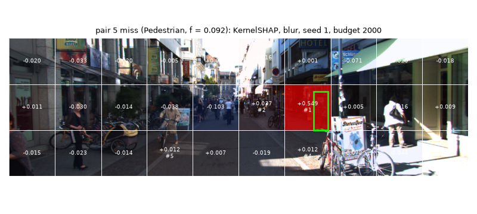
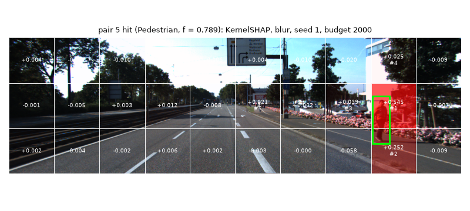
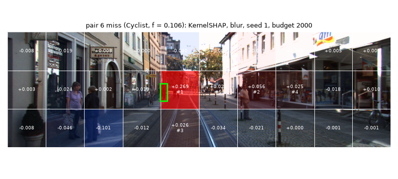
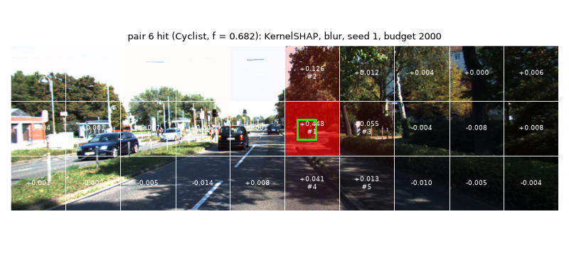
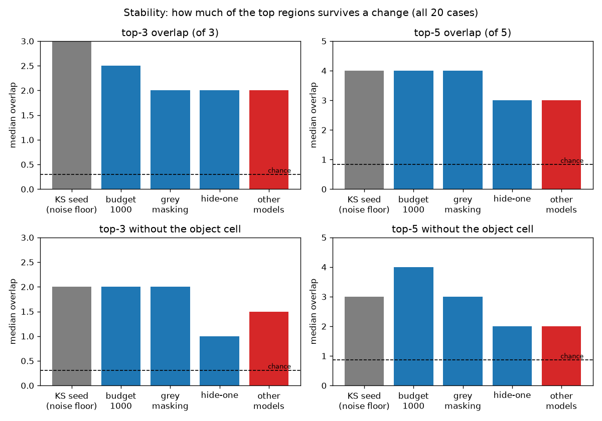
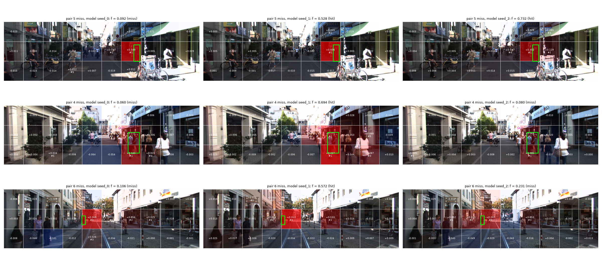
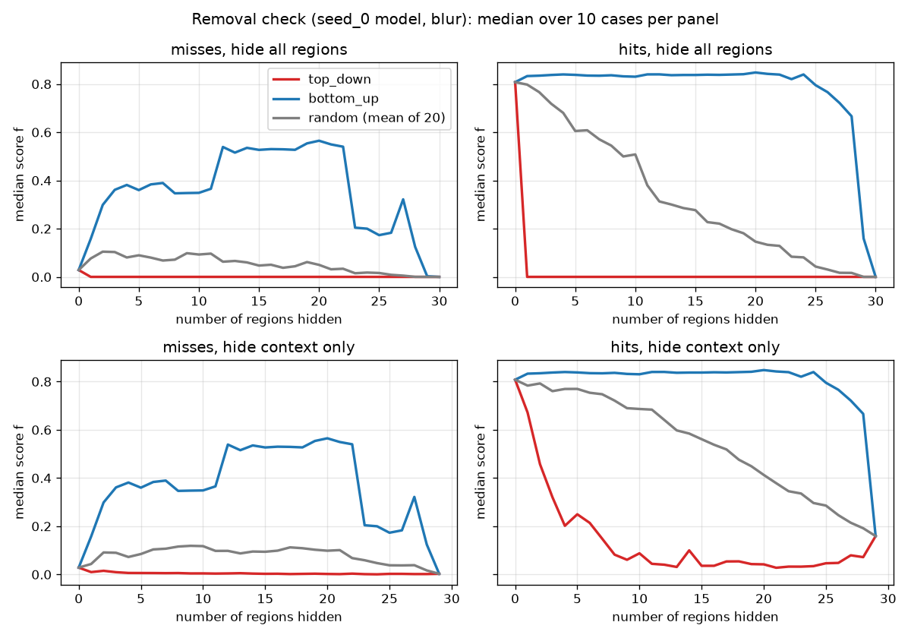

# Why does a detector miss a pedestrian or a cyclist? Regional Shapley values on KITTI and how far they can be trusted

November 2026

## Summary

I fine-tuned a small YOLO26 detector on KITTI and explained 10 pedestrians and cyclists that it misses, next to 10 matched ones that it finds. For each object I cut the picture into 30 regions and used KernelSHAP to see which regions the object's score depends on. Then I checked which conclusions survive a change of masking, sampling seed, sample budget and retrained copy of the model.

The object's own cell is the strongest region in 18 of the 20 cases, and it comes back whenever a setting changes. The surrounding regions are stable across seeds, budgets and the two maskings, and less stable across retrained copies (rank correlation 0.75 between seeds, 0.41 between models). Four of the 10 misses are detected by another copy. Hiding the cells that the map marks as negative lifts the score of the misses from a median of 0.03 to a peak of 0.63. Hiding the helpful cells lowers the score of the hits faster than hiding random cells.

The study has 10 misses and 10 hits, simple masking fills and one main model. The maps show what a score depends on, not what caused a miss.

## 1. Method

### Data and model

I used the left colour images and the training labels of the KITTI 2D object detection data (7,481 pictures). After dropping the DontCare areas and the pictures with a van, truck, tram, misc or sitting-person label, 4,016 remain. I split them at random into 3,213 for training and 803 for validation (seed 42). KITTI has no public test labels, so there is no test set. The 20 cases come from the validation pictures. Details are in [splits/DATASET.md](splits/DATASET.md).

The detector is YOLO26n from Ultralytics, fine-tuned for 100 epochs on three classes (Car, Pedestrian, Cyclist). I trained three copies that differ only in the training seed. Their validation mAP50 is 0.906, 0.907 and 0.898. Seed 0 is the main model. I use the one-to-one head of YOLO26 with a confidence floor of 0.001.

### Target score and cases

For a labelled object, the target score f is the highest confidence among boxes of its class that overlap the label box with an IoU of at least 0.5, or 0 if there is none. An object counts as detected when f is at least 0.25 (the library default).

I used pedestrians and cyclists in the validation pictures that are at least 40 pixels high, occluded at level 0 to 2 and truncated by at most 0.30. That gives 592 objects, and the seed 0 model misses 91 of them. I drew 10 misses at random (seed 42): 5 pedestrians and 5 cyclists, at most one per picture. Seven have a low score and three have no matching box. For each miss I chose a detected object of the same class and occlusion level, within 25 percent of its height, from another picture.

### Regions and masking

Each picture is cut into 10 columns and 3 rows, which makes 30 regions of about 124 by 125 pixels. A hidden region is filled before the model resizes the picture. In the main setting the fill comes from a blurred copy of the picture. The second setting uses flat grey (114). With all 30 regions hidden, f is 0 in all 20 cases.

### Explanations

KernelSHAP (shap 0.54.1) gives each region a Shapley value: its average effect on f when it is added to a random set of visible regions. The 30 values add up to f. Exact values would need about 1.07 billion model runs per picture, so KernelSHAP samples a limited number of combinations, the budget. I ran 8 settings per case: 2 maskings, 2 sampling seeds and 2 budgets (1,000 and 2,000). The base setting is blur, seed 1, budget 2,000. As a simple baseline I also hid one region at a time.

### Checks

I compare the base map with a changed map by the Spearman rank correlation over the 30 regions, and by how many of the top 1, 3 and 5 regions they share, also without the object's own cell. Two random maps share 0.03, 0.30 and 0.83 regions (0.31 and 0.86 without the object's cell). A second sampling seed on the same model gives the noise. The base setting on the seed 1 and seed 2 models gives the effect of training.

The removal check hides regions one at a time in KernelSHAP order, largest value first or most negative first, and in 20 random orders (seed 42). A second version never hides the object's own cell. I added the most-negative-first order and the second version after I had seen the first result.

## 2. Results

### 2.1 What the maps show

Figure 1 shows the base map of a missed pedestrian (pair 5) and its matched hit. Red cells raise the score, blue cells lower it, and the green box is the object. The 30 numbers add up to f.

*Figure 1. Pair 5, pedestrian. Top: the missed object (f = 0.092). Bottom: its matched hit (f = 0.789). KernelSHAP, blur, seed 1, budget 2,000, seed 0 model. Pictures from KITTI (Geiger et al., CC BY-NC-SA 3.0), see `results/maps_shared/ATTRIBUTION.md`.*

The strongest region is the cell around the object, in 18 of the 20 cases. In the other two, both from pair 4, the object is tall and covers two cells, and the top region is the other one. In all 20 cases the top region touches the object's box.

The difference between hits and misses is in the rest of the picture. In the hits, the object's cell has a median value of 0.51, and the other 29 cells add a median of 0.33 and take away 0.06. The missed pedestrian in Figure 1 has an equally strong object cell (+0.549), but f is only 0.092, because its other cells add +0.118 and take away 0.575. In 9 of the 10 misses the object's cell is worth more than the final score. In 7 misses the negative cells add up to less than -0.1, against 1 hit. Misses also have fewer helpful cells outside the object's cell: a median of 1 cell above 0.02, against 3.5 for hits.

Figure 2 shows a cyclist pair. The cyclist is small and sits inside one cell. The miss has an object cell of +0.269 and f = 0.106, and the hit has +0.448 and f = 0.682. When f is close to 0, as for the missed pedestrian in pair 1 (f = 0.003), the map is nearly flat.

*Figure 2. Pair 6, cyclist. Top: the missed object (f = 0.106). Bottom: its matched hit (f = 0.682). Same settings as Figure 1.*

These values show what the score depends on under this masking, not what caused a miss.

### 2.2 Stability across seed, budget and masking

Table 1 compares the base map with a map after one change. A new sampling seed comes first: seed 1 against seed 2 on the same model, masking and budget shows how much two runs differ by chance, and every other change is read against that. A smaller budget is noisier, so I measured the noise at budget 1,000 too.

*Table 1. Medians over 10 cases per group. Chance for the top 5 is 0.83, and 0.86 without the object's cell.*

| Change | Group | rho | Top 1 same | Top 5 | Top 5 without object cell |
|---|---|---|---|---|---|
| Noise: new seed, budget 2,000 | misses | 0.80 | 100% | 3.5 | 3.0 |
| | hits | 0.71 | 90% | 4.0 | 4.0 |
| Noise: seed 1 against seed 2, both at budget 1,000 | misses | 0.68 | 100% | 3.0 | 2.0 |
| | hits | 0.62 | 100% | 4.0 | 4.0 |
| Budget 1,000 | misses | 0.69 | 100% | 4.0 | 3.0 |
| | hits | 0.64 | 90% | 4.0 | 4.0 |
| Grey masking | misses | 0.77 | 100% | 4.0 | 3.0 |
| | hits | 0.71 | 100% | 4.0 | 3.5 |
| Hide-one baseline | misses | 0.56 | 80% | 2.0 | 2.0 |
| | hits | 0.43 | 90% | 3.0 | 3.0 |

*Figure 3. Median overlap of the top regions for each change. Grey is the sampling noise, blue are other settings, red is another trained model. The dashed line is chance.*

Two runs with different seeds do not give the same ranking (rho 0.80 and 0.71), but the best region is the same in 19 of the 20 cases. The low correlations come from the 25 or so cells near zero, whose order changes with every run. In pair 3 (miss) the two seeds give rho 0.39, our lowest, yet the object's cell is +0.169 and +0.174, and the cell below it is +0.078 and +0.084.

Halving the budget adds noise and nothing else that I can see. A 1,000 map agrees with the 2,000 map at 0.69 and 0.64, and two 1,000 maps agree with each other at 0.68 and 0.62. Grey masking gives 0.77 and 0.71, the same as a new seed, with the same best region in all 20 cases. The size of the values moves more than the ranking: in pair 4 (hit) the top cell is +0.320 with blur and +0.417 with grey.

The hide-one baseline agrees least. It finds the same best region in 17 of the 20 cases, but only 2 of the top 5 for the misses. It hides one region while all others stay visible, so two cells that show the same thing can hide each other. For the missed pedestrian in pair 5, hiding the cell above the object lowers f by 0.477, while KernelSHAP gives that cell -0.071. I did not test this explanation.

Without the object's own cell, the seed, budget and masking changes still share at least 2 of the top 3 surrounding regions, where chance gives 0.31. The least stable cases are pair 3 (miss, f = 0.238) and two hits whose objects are taller than a cell (pair 4, 148 pixels, and pair 5, 130 pixels).

### 2.3 Training luck: three copies of the model

The three copies have almost the same validation scores, yet they disagree on single objects. I repeated the base setting on the seed 1 and seed 2 models for the same 20 objects. Of the 10 misses of the main model, 4 are detected by at least one other copy (Table 2), pair 5 by two. All 10 hits stay hits in all copies, with scores that move a lot (pair 2: 0.509, 0.686 and 0.336). I picked the misses with the seed 0 model, so part of this is a selection effect. I did not measure how much.

*Table 2. Target score f of the four misses that another copy detects (0.25 or more counts as detected).*

| Object | Seed 0 | Seed 1 | Seed 2 |
|---|---|---|---|
| Pair 4, pedestrian | 0.060 | 0.694 | 0.080 |
| Pair 5, pedestrian | 0.092 | 0.528 | 0.732 |
| Pair 6, cyclist | 0.106 | 0.572 | 0.231 |
| Pair 9, cyclist | 0.001 | 0.651 | 0.060 |

The maps differ more between models than between sampling seeds (Table 3). Every pair of models has the same best region, so all copies look at the object's own cell. After that the rank correlation is 0.41 between models and 0.75 between seeds. Without the object's cell, the median case shares 2 of the top 5 regions between models and 3 between seeds (chance 0.86). For the four objects with disagreeing verdicts the gap is wider: 3.5 across seeds and 1.0 across models.

*Table 3. Medians. The first and third rows are the same model with another sampling seed.*

| Comparison | n | rho | Top 5 | Top 5 without object cell |
|---|---|---|---|---|
| Same model, other seed, all 20 cases | 20 | 0.75 | 4.0 | 3.0 |
| Different models, all 20 cases | 60 | 0.41 | 3.0 | 2.0 |
| Same model, other seed, the 4 objects above | 4 | 0.85 | 4.0 | 3.5 |
| Different models, the 4 objects above | 12 | 0.24 | 2.0 | 1.0 |

*Figure 4. Rows: pair 5 (pedestrian), pair 4 (pedestrian) and pair 6 (cyclist), all missed by seed 0. Columns: models seed 0, 1 and 2, with their score f. Pictures from KITTI (Geiger et al., CC BY-NC-SA 3.0), see `results/maps_shared/ATTRIBUTION.md`.*

In pair 5 the object's cell is strong in every model (+0.549, +0.606 and +0.452). The rest of the picture differs. For seed 0 the negative cells add up to -0.575 and cancel most of the object's cell. For seeds 1 and 2 they add up to -0.134 and -0.116. In all four objects of Table 2, the seed 0 map has the largest sum of negative cells (pair 4: -0.306 against -0.141 and -0.116; pair 9: -0.193 against -0.108 and -0.124; pair 6: -0.350 against -0.172 and -0.323). Four objects chosen with seed 0 are few, so I treat this as a hint, and section 2.4 looks at it. The cyclist in pair 6 shows how sharp the 0.25 limit is: seed 2 gives f = 0.231.

A map describes one trained model. I measured the sampling noise on the main model only, and I explained the other two models in the base setting only.

### 2.4 Removal check

If a map is useful, hiding regions in its order should change the score in a predictable way. On the seed 0 model, with blur masking and the base map, I hide regions one at a time and record f after each step: largest value first (top-down), most negative first (bottom-up), and 20 random orders (seed 42). I summarise each curve by its mean f. I use plain scores, because dividing by f with nothing hidden gives ratios up to 256 for misses. I ran two versions: any region may be hidden, or the object's cell stays visible.

*Table 4. Mean score f along the curve and the highest score of the bottom-up order. Medians over 10 cases per group.*

| Hidden regions | Group | f, nothing hidden | Top-down | Random | Bottom-up | Bottom-up peak |
|---|---|---|---|---|---|---|
| Any region | misses | 0.028 | 0.001 | 0.059 | 0.378 | 0.628 |
| Any region | hits | 0.808 | 0.028 | 0.337 | 0.748 | 0.871 |
| Not the object's cell | misses | 0.028 | 0.008 | 0.079 | 0.390 | 0.628 |
| Not the object's cell | hits | 0.808 | 0.162 | 0.523 | 0.773 | 0.871 |

*Figure 5. Median score f while regions are hidden. Red: largest value first. Blue: most negative first. Grey: random order. Top row: any region may be hidden. Bottom row: the object's cell stays visible. Left: misses. Right: hits.*

In the first version, top-down looks perfect: f falls to 0 after one hidden region in 18 of the 20 cases. But the first region is the object's own cell, so this is weak evidence. The second version is the real test. With the object's cell visible, the hits still lose most of their score when the helpful cells go first: the mean f is 0.16 against 0.52 for random orders, and top-down beats 19 or 20 of the 20 random orders in every hit. With only the object's cell left, the median hit has f = 0.159, against 0.81 with nothing hidden.

For the misses, top-down says little, because their score starts near 0. Bottom-up lifts it: the median peak is 0.63, the mean f is 0.39 against 0.08 for random orders, and it beats at least 15 of the 20 random orders in all 10 misses. The pedestrian in pair 5 goes from 0.092 to 0.868, pair 4 from 0.060 to 0.875, pair 6 from 0.106 to 0.869, and pair 8 (not one of the four with disagreeing verdicts) from 0.011 to 0.858. Random orders also lift some misses (the median random peak is 0.755 in pair 5), so part of the effect is less picture around the object. Pair 3 (miss, f = 0.238) does not fit: top-down beats only 7 of the 20 random orders there.

## 3. Limits

- The 0.25 limit is the library default. I did not test 0.1, 0.5 or other IoU limits. Pair 3 (f = 0.238) shows the risk.
- I have 10 misses and 10 hits, so medians are rough. I picked the misses with the seed 0 model, which is a selection effect. Only pedestrians and cyclists at least 40 pixels high are covered.
- Blur and grey are simple fills, and the masked pictures look unlike real ones. KernelSHAP and the removal check share the masking, so they could share an artifact. A cell of about 124 by 125 pixels is bigger than many objects.
- Only three models, and two of them in the base setting only. I measured the sampling noise on the main model only. I used the one-to-one head only: on one early test picture the default head gave 0.84 and the one-to-one head 0.87 for the same pedestrian.
- I trained on 4,016 of the 7,481 pictures, with no vans, trucks or trams. KITTI frames come from video sequences, so near-identical frames may sit in both the training and the validation set. I checked neither.
- The Shapley values show dependence under this masking, not cause. I did not show that clutter causes the misses. The bottom-up order and the second removal version came after I had seen the first result.
- All numbers come from one Windows computer with one GPU. The checkpoints are not published (KITTI and Ultralytics licences), so the GPU steps need a retrain of about 5 hours per model.

## 4. Reproducing the work, tools and credits

The repository has the code, the 20 cases, the raw results and one command that makes every table and figure: `python -m explain_adas.make_report`. The README explains how to reproduce the work, and `python -m explain_adas.smoke_test` checks the pipeline on two real cases in about 30 seconds.

Software: Python 3.12, PyTorch 2.14.1, Ultralytics 8.4.215 (YOLO26n), shap 0.54.1, NumPy 2.5.4, SciPy 1.18.1, Matplotlib 3.11.2, Pillow 13.0.0 and pytest 9.2.0, on one Windows computer with an NVIDIA GTX 1650.

Claude Code (Anthropic) assisted with writing, improving and debugging the code and scripts, and with drafting this report.

Credits:

- KITTI data: A. Geiger, P. Lenz and R. Urtasun, "Are we ready for Autonomous Driving? The KITTI Vision Benchmark Suite", CVPR 2012. CC BY-NC-SA 3.0. The five pictures shown here are under that licence (see `results/maps_shared/ATTRIBUTION.md`).
- KernelSHAP: S. Lundberg and S.-I. Lee, "A Unified Approach to Interpreting Model Predictions", NeurIPS 2017.
- YOLO26: Ultralytics, AGPL-3.0.
